# Nexora LMS — Diseño físico de la base de datos

Diseño físico de la base de datos de **Nexora LMS**, una plataforma de gestión de aprendizaje desarrollada con **Spring Boot + Thymeleaf** y **SQL Server**. El esquema está desplegado en **Azure SQL Database** y versionado mediante scripts SQL reproducibles.

## Diagrama

[](diagramas/modelo_fisico.png)

- [Diagrama general (SVG)](diagramas/modelo_fisico_general.svg)
- [Diagrama detallado con todas las columnas (PNG)](diagramas/modelo_fisico.png)
- [Diagrama detallado (SVG)](diagramas/modelo_fisico.svg)
- [Fuente editable Mermaid](diagramas/modelo_fisico.mmd)

## Tablas

| Tabla | Propósito | Filas demo |
| --- | --- | ---: |
| `usuario` | Cuentas de administrador, docente y estudiante | 10 |
| `categoria` | Categorías académicas de los cursos | 4 |
| `curso` | Cursos, docente responsable y categoría | 6 |
| `inscripcion` | Matrícula de estudiantes en cursos | 18 |
| `unidad` | Unidades que componen un curso | 11 |
| `leccion` | Lecciones dentro de una unidad | 21 |
| `material` | PDF, archivos de apoyo y enlaces | 10 |
| `actividad` | Tareas y cuestionarios | 8 |
| `pregunta` | Banco de preguntas de los cuestionarios | 9 |
| `opcion` | Alternativas y respuesta esperada | 25 |
| `entrega` | Entregas de tareas y cuestionarios | 9 |
| `respuesta` | Respuestas de los estudiantes | 3 |
| `calificacion` | Notas y retroalimentación | 7 |
| `aviso` | Comunicados por curso | 5 |
| `auditoria` | Registro de acciones del sistema | 10 |

## Relaciones principales

- `usuario` 1:N `curso` (docente responsable).
- `categoria` 1:N `curso`.
- `curso` 1:N `inscripcion` y `usuario` 1:N `inscripcion` (matrícula).
- `curso` 1:N `unidad` → `leccion` → `material`.
- `curso` 1:N `actividad`; `unidad` 0..1:N `actividad`.
- `actividad` 1:N `pregunta` → `opcion`.
- `actividad` 1:N `entrega`; `usuario` 1:N `entrega`.
- `entrega` 1:N `respuesta`; `pregunta` 1:N `respuesta`.
- `entrega` 1:1 `calificacion`.
- `curso` 1:N `aviso`; `usuario` 0..1:N `aviso`.
- `usuario` 0..1:N `auditoria`.

El esquema tiene **15 tablas**, **21 claves foráneas**, **19 índices no PK** y **8 restricciones unique**.

## Scripts

| Archivo | Contenido |
| --- | --- |
| `sql/01_schema.sql` | Tablas, PK, FK, UNIQUE, defaults e índices base |
| `sql/02_seed.sql` | Datos demo (usuarios, cursos, contenido, entregas, notas, avisos) |
| `sql/03_timestamps.sql` | Columnas de auditoría temporal en `pregunta`, `opcion` y `respuesta` |

Orden de ejecución:

```text
01_schema.sql → 02_seed.sql → 03_timestamps.sql
```

En Azure SQL Database la base ya existe, por lo que se ejecutan directamente sobre `nexora_lms`. En SQL Server local se debe crear primero la base y luego ejecutar los scripts.

Ejemplo con `sqlcmd`:

```powershell
sqlcmd -S <servidor>.database.windows.net -d nexora_lms -U <usuario> -P <contraseña> -N -C -b -f 65001 -i sql\01_schema.sql
sqlcmd -S <servidor>.database.windows.net -d nexora_lms -U <usuario> -P <contraseña> -N -C -b -f 65001 -i sql\02_seed.sql
sqlcmd -S <servidor>.database.windows.net -d nexora_lms -U <usuario> -P <contraseña> -N -C -b -f 65001 -i sql\03_timestamps.sql
```

## Despliegue en Azure

| Dato | Valor |
| --- | --- |
| Servidor | `srv-nexora-lms-oq18bd.database.windows.net` |
| Base de datos | `nexora_lms` |
| Región | `westus3` |
| SKU | `GP_S_Gen5_2` (Serverless) |
| Capa | Free tier (`useFreeLimit: true`) |
| Límite al agotar free tier | `AutoPause` (sin cobros) |
| Almacenamiento | 32 GB |
| Firewall | Restringido a IP autorizada |

Las credenciales **no** se almacenan en este repositorio.

## Decisiones de diseño

- Claves primarias `BIGINT IDENTITY(1,1)` en todas las tablas.
- `NVARCHAR` para soportar nombres y contenido en español.
- `DATETIME2` para fechas y horas; `DATE` para la fecha de matrícula.
- `DECIMAL(5,2)` para puntajes y calificaciones.
- `ON DELETE CASCADE` en las jerarquías: curso → inscripción/unidad/actividad/aviso, unidad → lección → material, actividad → pregunta → opción y actividad → entrega → respuesta/calificación.
- `UNIQUE` en `usuario.correo`, `categoria.nombre`, `curso.codigo`, `calificacion.entrega_id`, `inscripcion(curso_id, estudiante_id)`, `entrega(actividad_id, estudiante_id)`, `unidad(curso_id, orden)` y `leccion(unidad_id, orden)`.
- Índices en claves foráneas y en los filtros más usados por los dashboards (rol/estado de usuario, docente/estado de curso, estudiante/estado de inscripción y entrega, curso/estado de actividad, curso/estado/fecha de aviso).
- `material.subido_por` y `auditoria.usuario_nombre` son desnormalizaciones intencionales para conservar el dato histórico aunque el usuario cambie de nombre.
- Los estados (`rol`, `estado`, `tipo`) se controlan con enums en la aplicación; el esquema los almacena como `NVARCHAR(20/30)`.

## Verificación

- 15 tablas de usuario.
- 21 claves foráneas.
- 19 índices no PK.
- 8 restricciones unique.
- 10 usuarios, 6 cursos, 18 inscripciones, 8 actividades, 9 entregas y 7 calificaciones de ejemplo.
- Aplicación probada contra Azure: inicio de sesión correcto con el usuario estudiante `mateo.salazar@nexora.com`.

## Estructura

```text
nexora-lms-db/
├── README.md
├── diagramas/
│   ├── modelo_fisico_general.mmd/.svg/.png
│   └── modelo_fisico.mmd/.svg/.png
└── sql/
    ├── 01_schema.sql
    ├── 02_seed.sql
    └── 03_timestamps.sql
```

---

Proyecto académico — Universidad Peruana Los Andes.
